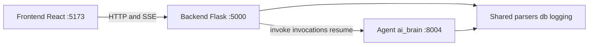

# Mate cluster map

This is a working map of the repo, not a split. Files stay where they are. Use a cluster to scope the next change: stay inside one layer unless the work actually crosses a bridge.

Source: Graphify `graph.json` from 2026-10-14 (3,135 nodes, 8,837 edges, 150 communities), rolled up by each node's `source_file`. Package-init, npm, font, icon, and launcher communities are dropped. The import graph cannot see HTTP; those seams are listed separately below.

| Cluster | Folder | Graph nodes | Source files | Pure communities |
|---------|--------|-------------|--------------|------------------|
| Agent | `ai_brain/` | 1,364 | 129 | 41 |
| Shared | `shared/` | 756 | 78 | 13 |
| Frontend | `frontend/` | 392 | 82 | 10 |
| Backend | `backend/` | 302 | 31 | 7 |

Import edges almost all go through shared: agent↔shared 647, backend↔shared 245, agent↔backend 59. Frontend has no import edges to backend or agent.

---

## How to use this map

1. Pick **one cluster** per change.
2. Touch **shared** only when parsers, DB models, or logging must change.
3. Touch a **bridge community** only when the change actually crosses a layer (upload parse, chat stream, pack build, identity).
4. Prefer this map over the README status table. Upload, KB, and comparison already exist in the graph.

---

## Agent — `ai_brain/`

LangGraph graphs (`nexus`, `procura`), KB extract/search, procurement skills, and the MLflow AgentServer on `:8004`.

### Runtime and graphs

- Agent Stream Protocol
- Streaming Channel Routing
- Thread Request Schemas
- Procura Capabilities
- Procura Main Agent
- Procura Deep Agent
- Procura Graph Indexing
- Nexus Procurement State
- Brain Server Bootstrap
- Brain Server Tests
- Brain Smoke Client
- MLflow Tracing
- Memory and Lakebase
- STM LTM Memory
- Lakebase Integration Tests
- Content Text Utils
- Studio Export Tests

### Knowledge base

- Artifact Snippet Ingest
- KB MCP Tools
- Bid Classification
- KB Build Runner
- KB Overview Views
- KB Hybrid Search
- Embedding Store
- KB Human in Loop
- Parse Pending Artifacts
- Project File Ingest
- Bid Chunk Prefetch
- Knowledge Prompt Context
- Knowledge Prompt Tests
- Requirement Enrichment

### Procurement packs and skills

- Agent Prompts and Skills
- Skill Pack Loader
- Indirect Matrix Writer
- Direct Matrix Writer
- Matrix LLM Extract
- Comparison Matrix Subagent
- Steerco Pack Builder
- Pack Insight Payload
- Alignment Review Agents
- Vendor Scenario Fixtures

Entry points: [`ai_brain/brain_server.py`](../ai_brain/brain_server.py), [`ai_brain/studio.py`](../ai_brain/studio.py) (`nexus` / `procura` in [`langgraph.json`](../langgraph.json)).

---

## Backend — `backend/`

Flask API on `:5000`. Routes, identity, pack orchestration, and the HTTP client that talks to the brain. Few communities stay backend-only; most Flask code sits in a bridge into shared.

Pure communities:

- Procurement API Payloads
- Actor Identity
- Local Pack Insights
- Upload Accept Tests
- KB Foundation SQLite
- Postgres Embedding DDL
- Backend Test Config

Entry points: [`backend/app.py`](../backend/app.py), blueprints in [`backend/routes/`](../backend/routes/).

---

## Frontend — `frontend/`

React hub and procurement vertical (Vite `:5173`). Talks to Flask only, via [`frontend/src/services/api.js`](../frontend/src/services/api.js).

- Hub Shell and Theme — hub page, theme, identity popup
- UI Primitive Components — shadcn/ui
- Dashboard and Dialogs — dashboard, create-project dialog
- Project Intake Upload — new project + documents tab
- Intake Chat Script — sessionStorage seed for workspace greeting
- Chat Panel UI — workspace chat panel
- Chat Thought Process / Chat Markdown Tables
- Analysis Step Rail — upload → KB → gaps → xlsx
- Studio Knowledge Graph UI

App code lives under `frontend/src/apps/procurement-ai-assistant/` and `frontend/src/pages/hub/`.

---

## Shared — `shared/`

Parsers, SQLite/UC persistence, Databricks runtime, logging. This is the real coupling layer. Changing it usually forces agent and backend to follow.

- Artifact Handler / Artifact Data Models
- Document Parse Errors
- PDF Block Geometry / PDF Chrome Layout / PDF Table Extraction
- Markdown Conversion / Document Chunking
- DB Paths and Tokens
- Volume File Storage
- Bronze Unity Catalog DDL
- SQLite KB Migration
- Vendor Shortlist Repo

---

## Bridge communities

These Graphify communities contain files from more than one layer. Thin bridges are usually a shared `models.py` import. Structural bridges are the ones to plan around.

### Structural — change these as a pair

| Community | Layers | What it is | Files |
|-----------|--------|------------|-------|
| Procurement Chat Client | backend, agent | Flask SSE chat → brain `/invocations` | [`backend/services/brain_client.py`](../backend/services/brain_client.py), [`backend/services/procurement_chat.py`](../backend/services/procurement_chat.py), [`ai_brain/core/procurement_ai/capabilities.py`](../ai_brain/core/procurement_ai/capabilities.py) |
| Artifact Upload Parse | backend, shared, agent | Upload persist + parse enqueue | [`backend/routes/procurement.py`](../backend/routes/procurement.py), [`backend/services/artifact_parse.py`](../backend/services/artifact_parse.py), [`shared/db/repos/artifacts.py`](../shared/db/repos/artifacts.py), [`ai_brain/core/procurement_ai/file_ingest.py`](../ai_brain/core/procurement_ai/file_ingest.py) |
| Procurement Pack Routes | backend, shared | Pack/insight HTTP surface | [`backend/routes/packs.py`](../backend/routes/packs.py), [`backend/routes/procurement.py`](../backend/routes/procurement.py), [`shared/db/repos/projects.py`](../shared/db/repos/projects.py) |
| Pack Store Paths | agent, backend, shared | Pack files on volume / local disk | [`ai_brain/core/procurement_ai/packs/store.py`](../ai_brain/core/procurement_ai/packs/store.py), [`backend/services/procurement_packs.py`](../backend/services/procurement_packs.py), [`shared/db/volume_fs.py`](../shared/db/volume_fs.py) |
| Auth Identity Routes | backend, shared | Hub/auth/home + user rows | [`backend/routes/auth.py`](../backend/routes/auth.py), [`backend/routes/hub.py`](../backend/routes/hub.py), [`shared/db/repos/users.py`](../shared/db/repos/users.py), [`shared/db/repos/hub.py`](../shared/db/repos/hub.py) |
| Flask Request Logging | backend, shared | Request-id, client log ingest | [`backend/app.py`](../backend/app.py), [`backend/routes/logs.py`](../backend/routes/logs.py), [`shared/logger_global/`](../shared/logger_global/) |
| Project Repository | shared, backend | Project CRUD tested from Flask | [`shared/db/repos/projects.py`](../shared/db/repos/projects.py), [`backend/tests/test_procurement_store.py`](../backend/tests/test_procurement_store.py) |
| Matrix From Evidence | agent, shared | Comparison matrix from evidence rows | [`ai_brain/core/procurement_ai/packs/matrix_from_evidence.py`](../ai_brain/core/procurement_ai/packs/matrix_from_evidence.py), [`shared/db/repos/evidence.py`](../shared/db/repos/evidence.py) |
| Bid Chunk Manifest | agent, shared | Bid chunks for search / matrix | KB extract + [`shared/db/models.py`](../shared/db/models.py), [`shared/db/connection.py`](../shared/db/connection.py) |
| Extraction Job Store | agent, shared, backend | KB job status mirrored to serializers | [`ai_brain/core/kb/extract/job_store.py`](../ai_brain/core/kb/extract/job_store.py), [`backend/services/procurement_serializers.py`](../backend/services/procurement_serializers.py) |
| KB Build Dispatch | agent, jobs | Thread vs Databricks job mode | [`ai_brain/core/kb/extract/dispatch.py`](../ai_brain/core/kb/extract/dispatch.py), [`jobs/kb_build_task.py`](../jobs/kb_build_task.py) |
| BAFO Comparison Template | agent, backend | Shared BAFO workbook template | [`ai_brain/core/procurement_ai/comparison_template.py`](../ai_brain/core/procurement_ai/comparison_template.py), [`backend/tests/test_bafo_template.py`](../backend/tests/test_bafo_template.py) |
| Databricks Runtime Client | shared, agent | WorkspaceClient, OBO, CLI profile | [`shared/databricks_runtime.py`](../shared/databricks_runtime.py), [`ai_brain/core/config/llm.py`](../ai_brain/core/config/llm.py) |
| UC Backend Middleware | shared, agent | OBO bind + UC connection | [`ai_brain/server/middleware.py`](../ai_brain/server/middleware.py), [`shared/db/connection.py`](../shared/db/connection.py) |
| Checkpointer and Store | agent, shared | Lakebase / SQLite checkpointer | [`ai_brain/server/checkpointer.py`](../ai_brain/server/checkpointer.py), [`shared/databricks_runtime.py`](../shared/databricks_runtime.py) |
| Agent Request Adapter | agent, shared | MLflow `/invoke` `/stream` + identity | [`ai_brain/server/agent.py`](../ai_brain/server/agent.py), [`ai_brain/server/request.py`](../ai_brain/server/request.py) |
| LLM Model Config | agent, shared | Gateway model names | [`ai_brain/core/config/llm.py`](../ai_brain/core/config/llm.py) |
| Notes and Chunk Repos | shared, agent | Notes + chunk persistence | [`shared/db/repos/notes.py`](../shared/db/repos/notes.py), [`shared/db/repos/chunks.py`](../shared/db/repos/chunks.py) |
| Job and DB Models | shared, agent | SQLAlchemy models, seed, jobs | [`shared/db/models.py`](../shared/db/models.py) |
| Procurement Ontology Fixtures | agent, backend | Frozen matrix catalogs | [`ai_brain/core/procurement_ai/ontology.py`](../ai_brain/core/procurement_ai/ontology.py), [`backend/tests/test_ontology_fixture.py`](../backend/tests/test_ontology_fixture.py) |

### Thin — shared models pulled into an agent community

KB Evidence Schemas, KB Graph Store, Bid Profile Extraction, KB Materialize Store, KB Agent Middleware. Treat as agent work plus [`shared/db/models.py`](../shared/db/models.py).

Product Surface Docs mixes README, `app.yaml`, `databricks.yml`, and `resources/*.yml`. That is deploy/docs, not runtime coupling.

---

## HTTP and SSE seams

Graphify only sees imports. Frontend never imports backend or `ai_brain`. The live contract is HTTP.

Flask (`API_BASE` in DEV is `http://<host>:5000`) is the only server the browser calls. The brain is reached from Flask via `BRAIN_BASE_URL` (default `http://127.0.0.1:8004`).

### Frontend → Flask

| Client | Method | Path |
|--------|--------|------|
| Hub | GET | `/api/auth`, `/api/hub` |
| Navbar | GET | `/api/auth` |
| Logger | POST | `/api/logs` |
| Dashboard | GET | `/api/procurement/dashboard` |
| Projects list | GET | `/api/procurement/projects` |
| Create project | GET / POST | `/api/procurement/projects/next-code`, `/api/procurement/projects` |
| Project | GET / PATCH / DELETE | `/api/procurement/projects/:id` |
| Upload | POST multipart | `/api/procurement/projects/:id/files` |
| File vendor | PATCH | `/api/procurement/projects/:id/files/:artifactId/vendor` |
| Documents | GET | `/api/procurement/projects/:id/documents` |
| Overview / requirements / vendors | GET | `/api/procurement/projects/:id/{overview,requirements,vendors}` |
| Requirement review | PATCH / DELETE | `/api/procurement/projects/:id/requirements/:rid/vendors/:bidId` |
| Notes | GET / POST / DELETE | `/api/procurement/projects/:id/notes` |
| Workspace | GET | `/api/procurement/projects/:id/workspace` |
| Chat sessions | GET / POST / GET | `/api/procurement/projects/:id/workspace/sessions`, `.../sessions/:sessionId` |
| Workspace chat SSE | POST SSE | `/api/procurement/projects/:id/workspace/chat/stream` |
| Insights / packs | GET / POST / GET | `/api/procurement/projects/:id/insights`, `.../packs`, `.../packs/:kind`, `.../packs/:kind/download` |
| KB rebuild | POST | `/api/procurement/projects/:id/packs/kb` |

Client helpers: [`frontend/src/services/api.js`](../frontend/src/services/api.js) (`apiGet`, `apiPost`, `apiPostForm`, `apiPostSse`). Stream consumer: [`useWorkspaceChatStream.js`](../frontend/src/apps/procurement-ai-assistant/pages/project-detail/workspace/components/useWorkspaceChatStream.js).

### Flask → Agent

| Flask | Brain |
|-------|-------|
| [`brain_client.post_invoke`](../backend/services/brain_client.py) | `POST /invoke` |
| [`brain_client.iter_invocations_sse`](../backend/services/brain_client.py) | `POST /invocations` (SSE) |
| [`brain_client.resume`](../backend/services/brain_client.py) | `POST /v1/threads/{id}/resume` |
| Pack workers in [`procurement_packs.py`](../backend/services/procurement_packs.py) | same brain base URL |

Flask also imports agent modules in-process for ingest limits (`file_ingest.MAX_FILES`) and capability names. That is the 59 agent↔backend import edges.

---

## Supporting folders (not working clusters)

Keep these out of day-to-day feature work unless the change is deploy or batch:

- [`jobs/kb_build_task.py`](../jobs/kb_build_task.py) — Databricks KB build job (bridge: KB Build Dispatch)
- [`resources/`](../resources/) — Databricks Apps / job YAML
- [`power_app/`](../power_app/) — separate Streamlit experiment
- [`run_app.py`](../run_app.py), [`start-dev.ps1`](../start-dev.ps1) — process launchers
